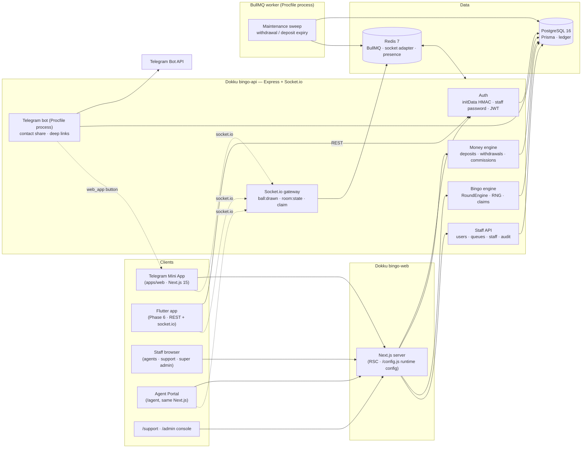
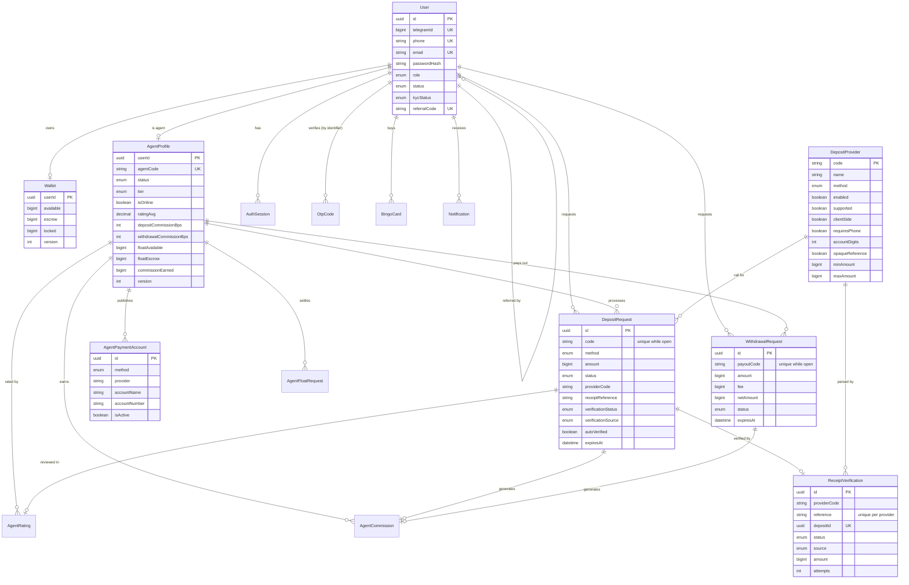
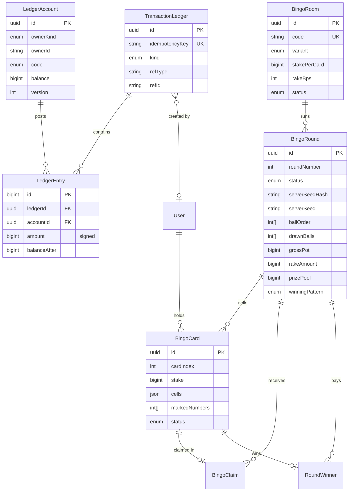
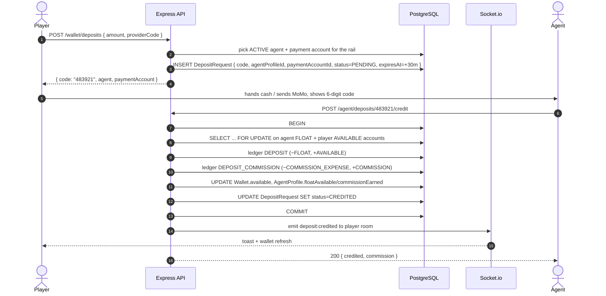
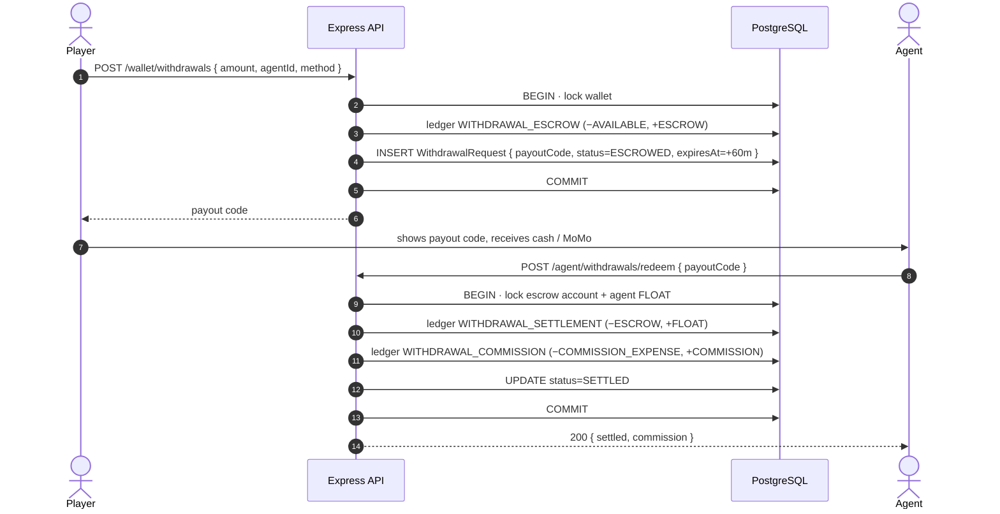
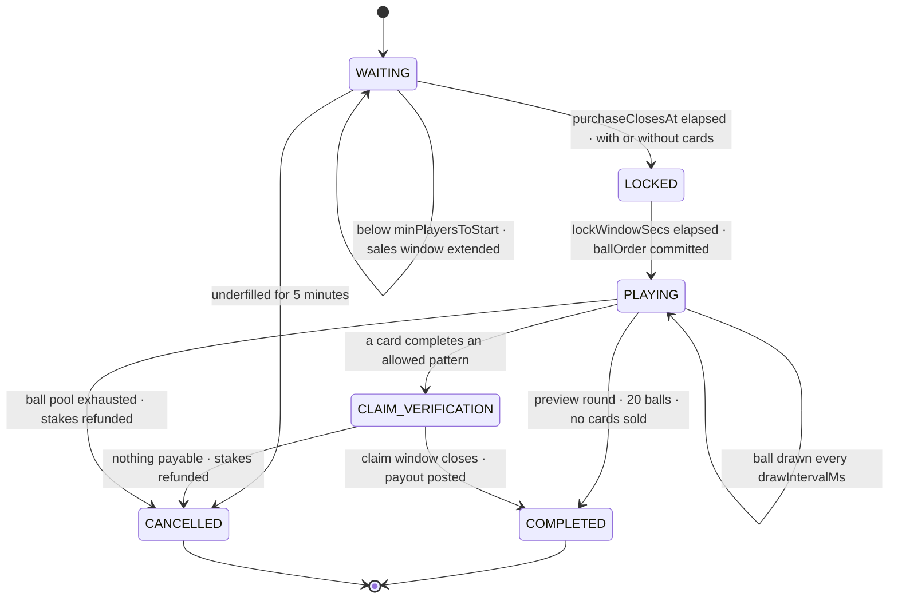

# Bingo Casino Platform — Architecture

> Companion to [`apps/api/prisma/schema.prisma`](../apps/api/prisma/schema.prisma) and
> [`apps/api/prisma/sql/constraints.sql`](../apps/api/prisma/sql/constraints.sql).

---

## 1. System topology

One Next.js codebase (`apps/web`) serves the Telegram Mini App and the browser-only staff
console (agent portal, `/support`, `/admin`). Players onboard through the Telegram bot;
staff accounts are provisioned by a super admin and never use Telegram login. A Flutter
mobile app (Phase 6) will call the same API. One Express + Socket.io process serves the
realtime game and the REST API on Dokku, with separate `Procfile` processes for BullMQ
housekeeping and the grammY bot. Round timing lives in an in-process `RoundEngine` that
is the sole writer of `BingoRound.status`; every transition takes a Postgres advisory
lock, so a second API replica can never double-draw. BullMQ owns durable housekeeping
(expiry, payouts).

### Process boundary rules

| Rule | Why |
| --- | --- |
| Only `RoundEngine` transitions `BingoRound.status` | One code path for WAITING → LOCKED → PLAYING → settlement |
| Every transition holds `pg_advisory_xact_lock(roundId)` | Two replicas cannot draw or settle the same round twice |
| Socket handlers are money-safe by delegation | `cards:buy` / `claim:submit` call the same services as REST |
| One `ledger` service writes every balance | Single place for locking, idempotency, and double-entry |
| The BullMQ worker only performs idempotent housekeeping | API restarts never interrupt a live round |
| Exactly one `bot` process long-polls Telegram | Two pollers hit `409 Conflict` |
| `phoneVerifiedAt` is written only by the bot contact flow | `initData` cannot prove a phone number, and web signup is disabled |

---

## 2. Data model

### 2.1 Identity, wallet, agent network

`OtpCode` is keyed by `identifier` (phone/email). OTP never creates an account: it is a
login aid for existing staff and the challenge used when linking a phone. Players are
created only by the bot, and `phoneVerifiedAt` is written only by the contact-share flow.

### 2.2 Ledger and bingo

`(roomId, roundNumber)` is unique. A partial unique index guarantees **one active round
per room**, which is what makes the round scheduler safe to run on many workers.

---

## 3. Money: chart of accounts

Every flow is a balanced journal. All amounts are `BigInt` minor units (1 credit = 100).
Sign convention: **debit = negative**, **credit = positive**.

| Account | Owner | Legal balance | Meaning |
| --- | --- | --- | --- |
| `AVAILABLE` | USER | ≥ 0 | Spendable credits |
| `ESCROW` | USER | ≥ 0 | Locked by a pending withdrawal |
| `LOCKED` | USER | ≥ 0 | Staked in a live bingo round |
| `FLOAT` | AGENT | ≥ 0 | Agent's pre-funded liquidity |
| `FLOAT_ESCROW` | AGENT | ≥ 0 | Float locked by a pending cash-out |
| `COMMISSION` | AGENT | ≥ 0 | Accrued commission (withdrawable via cash-out) |
| `RAKE` | PLATFORM | ≥ 0 | House share of rounds |
| `COMMISSION_EXPENSE` | PLATFORM | **may be negative** | Cost of agent commissions (expense account, accrues negative) |
| `TREASURY` | PLATFORM | ≥ 0 | Operating balance |
| `SUSPENSE` | PLATFORM | **may be negative** | Bridge to the outside world (bank/MoMo in transit) |

### 3.1 Movement matrix

| Event | Debit (−) | Credit (+) | LedgerKind |
| --- | --- | --- | --- |
| SuperAdmin credits agent float | `PLATFORM.SUSPENSE` | `AGENT.FLOAT` | `AGENT_FLOAT_TOP_UP` |
| Agent cashes float out to bank | `AGENT.FLOAT` → `FLOAT_ESCROW` | then `PLATFORM.SUSPENSE` | `AGENT_FLOAT_CASH_OUT` |
| Player deposit via agent | `AGENT.FLOAT` | `USER.AVAILABLE` | `DEPOSIT` |
| Deposit commission (3%) | `PLATFORM.COMMISSION_EXPENSE` | `AGENT.COMMISSION` | `DEPOSIT_COMMISSION` |
| Withdrawal escrow | `USER.AVAILABLE` | `USER.ESCROW` | `WITHDRAWAL_ESCROW` |
| Agent pays cash, redeems payout code | `USER.ESCROW` (full amount) | `AGENT.FLOAT` (net payout) + `PLATFORM.TREASURY` (fee) | `WITHDRAWAL_SETTLEMENT` |
| Withdrawal commission (2%) | `PLATFORM.COMMISSION_EXPENSE` | `AGENT.COMMISSION` | `WITHDRAWAL_COMMISSION` |
| Withdrawal expires / cancelled | `USER.ESCROW` | `USER.AVAILABLE` | `WITHDRAWAL_REFUND` |
| Player buys cards | `USER.AVAILABLE` | `USER.LOCKED` | `CARD_PURCHASE` |
| Round payout | all `USER.LOCKED`, `PLATFORM.RAKE` | winner `USER.AVAILABLE` | `ROUND_PAYOUT` |
| Round cancelled | `USER.LOCKED` | `USER.AVAILABLE` | `ROUND_REFUND` |

> The physical cash an agent hands to a player never touches the platform. The agent is
> reimbursed implicitly: their float decreases on deposit and increases on withdrawal.

### 3.2 Deposit flow

Failure paths: insufficient agent float → `409 FLOAT_INSUFFICIENT`; expired code →
`410`; a second credit attempt for the same `code` is blocked by the
`(refType, refId, kind)` unique index **and** the idempotency key, so double-tapping the
agent button is harmless.

#### Receipt verification

A deposit created against a `DepositProvider` carries a receipt reference instead of a
handshake. Verification lives in `apps/api/src/services/receipts/`: each bank gets a
parser that canonicalizes the reference, knows which inputs it needs (last account
digits, phone) and builds the receipt URL from a **static host allowlist**. Fetching
enforces a response size cap, follows redirects manually, and retries only on network
errors and 5xx.

Two shapes exist:

- **Server-side** — the API fetches the bank page after creation and records a
  `ReceiptVerification` row.
- **Client-side** (Telebirr, M-Pesa) — the bank blocks Ethiopian-IP-only traffic, so the
  API returns `clientReceiptUrl`; the payer app fetches it and posts the raw body to
  `/wallet/deposits/:code/verify-receipt`. That payload is untrusted: the server
  re-parses it, dedupes by `(providerCode, reference)`, and compares the parsed amount
  and receiver against the deposit before it may credit.

Auto-credit is a single locked transaction and requires: assigned agent `ACTIVE`, agent
automation on, amount ≤ agent threshold, rail enabled/supported, gate `VERIFIED`, parsed
amount exactly equal to the deposit, receiver matching the agent's payment account, and
an unused reference (partial unique index on credited deposits). Any miss leaves the
deposit for manual agent confirmation. Verification rows store the source
(`SERVER`/`CLIENT`/`RELAY`) so support can tell attested data from operator action.

### 3.3 Withdrawal flow

If the player never meets the agent the request expires; the BullMQ maintenance sweep
(or the in-process fallback when Redis is absent) posts `WITHDRAWAL_REFUND` and returns
escrow to `AVAILABLE`.

---

## 4. Bingo round lifecycle

A round that sold no cards still starts and draws a short preview (20 balls at a
faster cadence) so anyone watching sees a real, verifiable draw; it then completes
with no pot, and the room reopens for sales.

Ownership: `RoundEngine` (inside the API process) owns the clock. It polls each open room
with a single timer, calls `lockRound` at `purchaseClosesAt`, draws one ball per
`drawIntervalMs`, opens `CLAIM_VERIFICATION` as soon as the server detects a completed
pattern, and settles when `claimsCloseAt` elapses. The socket gateway subscribes to the
service's event bus and broadcasts the resulting facts; it never mutates a round itself.
Two API replicas are safe because each transition re-reads the round under
`pg_advisory_xact_lock(roundId)` and checks the expected status. Card purchase takes
`room:<roomId>` then `round:<roundId>` in that order, so a slow purchase cannot commit
over a concurrent sales-close/cancel; no path ever takes the two locks in reverse.

### 4.1 Provably fair RNG

1. **Commit** — at `WAITING`, the worker generates `serverSeed = 32 random bytes`
   and publishes `serverSeedHash = sha256(serverSeed)` over the socket and REST lobby.
2. **Contribute** — each player may submit a `clientSeed` at card purchase; the round
   stores `clientSeed = sha256(sorted per-user seeds joined by ":")` and
   `clientSeedCount`. Seeding closes at `LOCKED`.
3. **Derive** — `finalSeed = HMAC_SHA256(key = serverSeed, msg = clientSeed + ":" + nonce)`.
4. **Shuffle** — Fisher–Yates over `[1..75]` (or `[1..90]`) using 32-bit chunks of
   `HMAC_SHA256(finalSeed, counter++)` with rejection sampling, producing `ballOrder`.
5. **Reveal** — at `COMPLETED` (or `CANCELLED`), the round snapshot publishes
   `serverSeed`, `clientSeed` and `ballOrder`. `GET /bingo/rounds/:id/verify` also
   returns every card's contributed `clientSeed` and a server-side recomputation, so
   anyone can rebuild the aggregated seed, the ball order, and `sha256(serverSeed)`.

Server-side win validation, not client trust: the server holds `drawnBalls`, the card's
`cells`, and the variant's pattern table. A `BingoClaim` is accepted only if every cell
in the claimed pattern is present in `drawnBalls`; the snapshot is stored on the claim
row as audit evidence. Claims are advisory — if the claim window closes with no valid
manual claim, settlement re-evaluates every card and still pays the detected winners.
Simultaneous winners split `prizePool` equally; the leftover minor units go to the
earliest winners so the shares sum exactly to the pool.

### 4.2 Cards and patterns

| Variant | Layout | Numbers | Patterns implemented |
| --- | --- | --- | --- |
| `US_75` | 5×5, FREE centre | 24 drawn numbers, columns B 1-15 … O 61-75 | `HORIZONTAL` `VERTICAL` `DIAGONAL` `FOUR_CORNERS` `FULL_HOUSE` |
| `UK_90` | 3×9 ticket, 15 numbers | 5 per row, 1-3 per column, ascending, column ranges 1-9 … 80-90 | `HORIZONTAL` `FULL_HOUSE` |

`BingoCard.cells` stores the matrix as JSON (`{ variant, rows, cols, freeCenter, grid }`)
with `null` for blanks and the free space. Rooms snapshot `variant`, `stakePerCard`,
`rakeBps` and `allowedPatterns` onto each round, so editing a room never changes a
live round.

### 4.3 Buying, settlement and refunds

- **Buy** — `AVAILABLE → LOCKED` for `stake × quantity`, one journal keyed
  `card-purchase:<roundId>:<userId>:<idempotencyKey>`. `cardsSold`, `grossPot`,
  `rakeAmount`, `prizePool` are updated in the same transaction; the pot invariant
  `grossPot = rakeAmount + prizePool` always holds.
- **Settle** — one `ROUND_PAYOUT` journal: every card's `LOCKED` stake is debited, the
  prize shares are credited to winners' `AVAILABLE`, and `rakeAmount` goes to
  `PLATFORM.RAKE`. It is created with `(refType='BingoRound', refId=roundId)` so a
  retry can never pay twice.
- **Refund** — cancellation posts `ROUND_REFUND` and flips cards to `REFUNDED`.

---

## 5. Concurrency and integrity

| Concern | Control |
| --- | --- |
| Double credit / double debit | `TransactionLedger.idempotencyKey` unique + partial unique `(refType, refId, kind)` (all kinds except `CARD_PURCHASE`, which is many-per-round) |
| Lost update on balances | `SELECT … FOR UPDATE` inside `$transaction`, accounts locked in ascending UUID order |
| Deadlocks | Deterministic lock order + retry on `40001` / `40P01` (max 3) |
| Slow hosted database | Interactive transactions run with `maxWait 10s / timeout 20s` via `runTransaction` instead of Prisma's 5s default |
| Two rounds in one room | Partial unique index `BingoRound_one_active_per_room` |
| Purchase vs. sales close | `buyCards` takes `room:` then `round:` advisory lock; `lockRound`/`cancelRound` take `round:` |
| Two live withdrawals per player | Partial unique index on open withdrawals |
| Negative balances | DB `CHECK` constraints + service-level guard |
| Unbalanced journal | Deferred constraint trigger on `LedgerEntry` |
| Journal tampering | `BEFORE UPDATE/DELETE` triggers raise |
| Cache drift | `v_account_drift` reconciliation view must stay empty |
| Draw / claim / settle race | `pg_advisory_xact_lock(roundId)` + status predicate on every transition |
| Repeat payout after retry | Ledger idempotency key `round-payout:<roundId>` for the whole pot |
| Round pot drift | All pot counters written in the same tx as the purchase journal |
| Agent float race | Row lock on `AGENT.FLOAT` account; credit rejected if `floatAvailable < amount` |
| Same receipt used twice | `ReceiptVerification @@unique([providerCode, reference])` + partial unique index on credited `DepositRequest.receiptReference` |
| Forged client receipt body | Treated as untrusted input: re-parsed by the code-owned parser, amount must equal the deposit and the receiver must match the agent account |
| Auto-credit above agent limit | Threshold checked inside the credit transaction against the locked `DepositRequest.amount` |
| Two verifications for one deposit | `ReceiptVerification.depositId` is unique (corrections update the row) |

Wallet/agent balances are **caches**. If a cache is ever in doubt, it is rebuilt from
`LedgerEntry` — the journal is the only financial source of truth.

---

## 6. Phase roadmap

| Phase | Scope | Status |
| --- | --- | --- |
| 1 | Prisma schema, SQL invariants, architecture | ✅ delivered |
| 2 | Express bootstrap, Telegram `initData` + JWT auth, agent deposit/withdrawal APIs, ledger service | ✅ delivered |
| 3 | Socket.io bingo engine, provably fair RNG, claim verification, BullMQ workers | ✅ delivered |
| 4 | Next.js TMA: lobby, live board, wallet, agent portal, fairness verifier; Dokku packaging | ✅ delivered |
| 5 | Telegram bot + phone verification, staff roles, support/admin consoles, staff Telegram linking, bank receipt verification + agent auto-deposit, Swagger, EN/AM localization | ✅ delivered |
| 6 | Flutter mobile app (same REST + Socket.io API) | pending |
